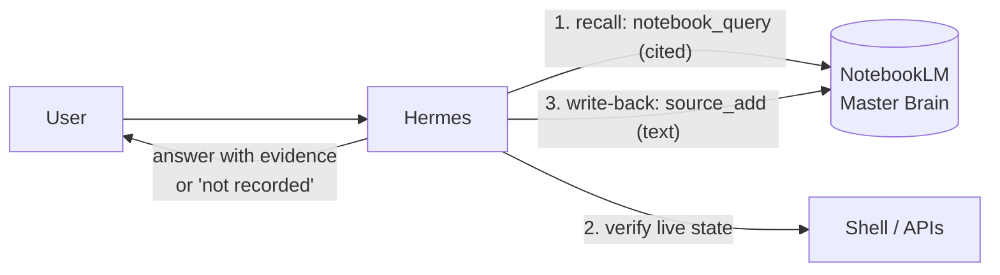

# hermes-agent-skills

Community skills for [Hermes Agent](https://github.com/NousResearch/hermes-agent).

| Skill | What it does |
|---|---|
| [`notebooklm-memory`](skills/notebooklm-memory/SKILL.md) | Long-term, **citation-grounded memory** using a Google NotebookLM (Gemini Notebook) "Master Brain" notebook through MCP: recall before answering, write back durable facts, and refuse to guess (anti-hallucination). |

## Install

```bash
git clone https://github.com/addhe/hermes-agent-skills.git ~/hermes-agent-skills
```

Add the repo's `skills/` directory to `~/.hermes/config.yaml`:

```yaml
skills:
  external_dirs:
    - ~/hermes-agent-skills/skills
```

Then restart Hermes, or the gateway service. To update later, run `git -C ~/hermes-agent-skills pull`.

Each skill lists its own prerequisites. `notebooklm-memory` needs the NotebookLM MCP server; see [setup.md](skills/notebooklm-memory/references/setup.md).

> [!TIP]
> On servers, clone into a root-owned, read-only location (e.g. `/opt/hermes-agent-skills`) so the agent can use the skills but not rewrite them. To pin a version, check out a tag.

## How `notebooklm-memory` works



- **Recall:** Hermes queries the Master Brain notebook before stating project-specific facts. NotebookLM answers only from its sources, with citations.
- **Anti-hallucination gate:** every factual claim must come from memory (cited), live tool output, or the user. If it comes from none of these, the agent says it doesn't know.
- **Write-back:** durable decisions, configs and fixes are appended as dated text sources (`mem/<date>/<project>-<topic>`). Writes are append-only, and secrets are redacted.
- **Health gate:** "MCP connected but 0 tools" counts as a failure, not a pass.

## Security

- This repo contains **no credentials**. Your NotebookLM login lives in `~/.notebooklm-mcp-cli/` on your machine. Never commit it or paste it into chat.
- Every push and pull request runs [`scripts/check-secrets.sh`](scripts/check-secrets.sh) and gitleaks over the full history. Contributors should run `bash scripts/install-hooks.sh` once.
- `notebooklm-mcp-cli` is an **unofficial** NotebookLM client. Use a dedicated Google account and respect Google's terms and rate limits.

## Contributing

PRs with new skills are welcome:

- Use one folder per skill under `skills/<name>/`, containing a `SKILL.md` with frontmatter `name`, `description`, `version`, `license`. The `name` must equal the folder name.
- No secrets, no private data, and no third-party content you don't have the right to relicense under MIT.
- Scripts must be portable bash and pass `shellcheck`.

## Komunitas (Indonesia)

Diskusi dan tanya jawab seputar Hermes Agent ada di Telegram: **[t.me/HermesAgentIndonesia](https://t.me/HermesAgentIndonesia)**

## License

[MIT](LICENSE) © 2026 Addhe Warman Putra (Awan)
